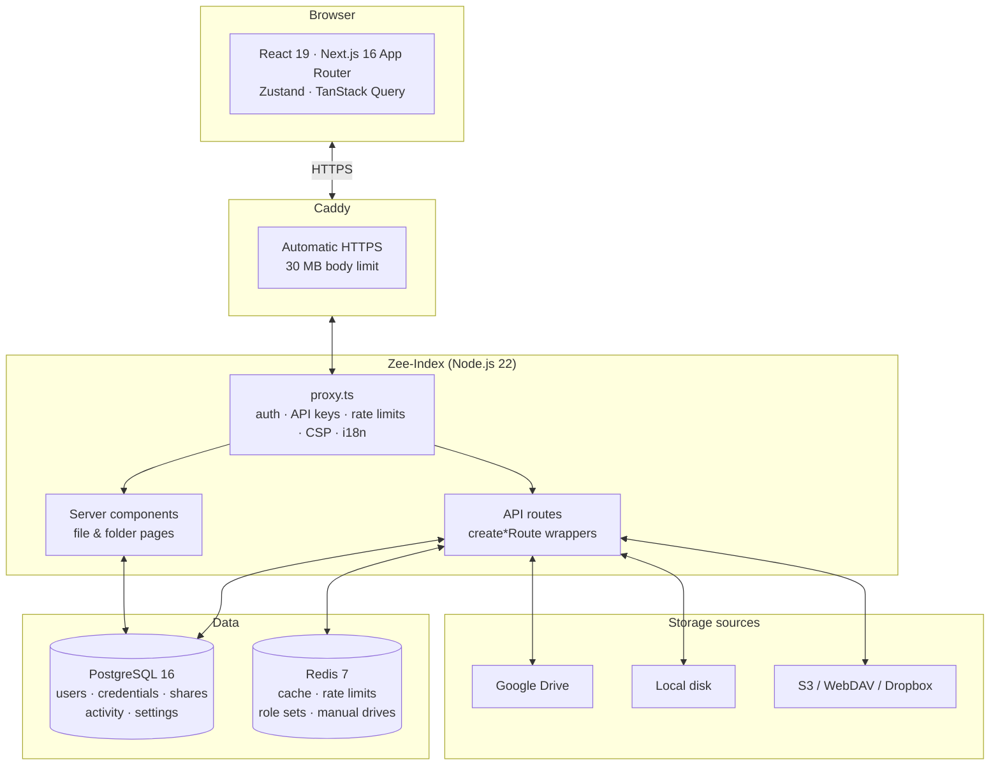

<div align="center">
  <a href="https://github.com/ifauzeee/Zee-Index">
    
  </a>

  <h1 align="center">Zee-Index</h1>

  <p align="center">
    Self-hosted file explorer and media streaming platform.
    One unified interface over Google Drive, Dropbox, S3/R2, WebDAV, and local storage.
  </p>

  <p align="center">
    <a href="https://github.com/ifauzeee/Zee-Index/stargazers">
      
    </a>
    <a href="https://github.com/ifauzeee/Zee-Index/forks">
      
    </a>
    <a href="LICENSE">
      
    </a>
    <a href="https://ifauzeee.vercel.app/projects/zee-index/preview">
      
    </a>
  </p>

  <p align="center">
    
    
    
    
    
    
    
    
    
  </p>
</div>

---

## Contents

- [Highlights](#highlights)
- [Quick Start](#quick-start)
- [Documentation](#documentation)
- [Features](#features)
- [Architecture](#architecture)
- [Tech Stack](#tech-stack)
- [Security at a Glance](#security-at-a-glance)
- [Requirements](#requirements)
- [Contributing](#contributing)
- [License](#license)

---

## Highlights

- **One file browser for every source.** Google Drive (including shared drives), local disk, S3 / Cloudflare R2 / MinIO, WebDAV (Nextcloud) and Dropbox, each as its own root.
- **Stream and preview in the browser.** Video with subtitles and resume, audio, images, PDF, code, Markdown, EPUB, Office documents and ZIP archives.
- **Share safely.** Links with expiry, max uses, sign-in requirement, download blocking and watermarks, for one file, a folder or a collection. A link opens exactly what was shared.
- **Control access.** Admin, editor, user and guest roles, password-protected folders, per-email grants, private folders, two-factor authentication.
- **Run it yourself.** One `docker compose up`: PostgreSQL, Redis, automatic HTTPS with Caddy, daily database backups, health checks and alerts.

---

## Quick Start

```bash
git clone https://github.com/ifauzeee/Zee-Index.git
cd Zee-Index
cp .env.example .env
```

Edit `.env`. At minimum, set:

| Variable                                    | Value                                                             |
| ------------------------------------------- | ----------------------------------------------------------------- |
| `NEXTAUTH_URL`                              | `http://localhost:3000` (or your `https://` domain)               |
| `NEXTAUTH_SECRET`                           | 32+ random characters (`openssl rand -hex 32`)                    |
| `SHARE_SECRET_KEY`                          | 32+ random characters                                             |
| `ADMIN_EMAILS`                              | Your email                                                        |
| `ADMIN_PASSWORD`                            | Your admin password (8+ characters, no `$`)                       |
| `POSTGRES_PASSWORD`                         | Database password                                                 |
| `CRON_SECRET`                               | 16+ random characters                                             |
| `GOOGLE_CLIENT_ID` / `GOOGLE_CLIENT_SECRET` | From your Google OAuth client ([how](docs/google-cloud-setup.md)) |

Then:

```bash
docker compose up -d --build
docker compose logs zee-index | grep -i "setup token"   # token for the setup wizard
```

Open `http://localhost:3000/setup`, enter the setup token and authorize Google Drive. Restart with `docker compose up -d --build`, and sign in at `/login` with `ADMIN_EMAILS` / `ADMIN_PASSWORD`.

The full walkthrough is in **[Getting Started](docs/getting-started.md)**.

---

## Documentation

| Guide                                            | Covers                                                                      |
| ------------------------------------------------ | --------------------------------------------------------------------------- |
| [Getting Started](docs/getting-started.md)       | Installation, first-run setup, first sign-in                                |
| [Google Cloud Setup](docs/google-cloud-setup.md) | OAuth client, redirect URIs, test users, troubleshooting                    |
| [Configuration](docs/configuration.md)           | Every environment variable and admin setting                                |
| [Storage Providers](docs/storage-providers.md)   | Drive, manual drives, local, S3/R2/MinIO, WebDAV, Dropbox, upload limits    |
| [Deployment](docs/deployment.md)                 | VPS, HTTPS (own domain, DuckDNS), reverse proxies, cron, backups, updates   |
| [User & Admin Guide](docs/user-guide.md)         | Browsing, previews, search, sharing, file requests, admin panel             |
| [Security](docs/security.md)                     | Roles, sessions, 2FA, protected folders, share links, API keys, rate limits |
| [API Reference](docs/api/README.md)              | Every endpoint with its access level, plus examples                         |
| [Development](docs/development.md)               | Local setup, project structure, conventions, testing, CI                    |
| [FAQ & Troubleshooting](docs/FAQ.md)             | Common problems and fixes                                                   |

---

## Features

### Storage

| Feature                | Description                                                                             |
| ---------------------- | --------------------------------------------------------------------------------------- |
| **Google Drive**       | A root folder or the whole drive, plus extra folders and shared drives as manual drives |
| **Local storage**      | Serve a directory on the server, with an optional password for the whole root           |
| **S3 / R2 / MinIO**    | Any S3-compatible bucket, with multipart uploads for large files                        |
| **WebDAV**             | Nextcloud, ownCloud or any WebDAV server, confined to a base path                       |
| **Dropbox**            | Full Dropbox or an app folder, with automatic token refresh                             |
| **Private folders**    | Hidden from everyone except admins                                                      |
| **Storage monitoring** | Usage per source, quota warnings by email                                               |

### Preview and playback

| Feature            | Description                                                                               |
| ------------------ | ----------------------------------------------------------------------------------------- |
| **Video**          | Streaming player (VidStack) with seeking, resume, picture-in-picture, speed control       |
| **Subtitles**      | `.srt` / `.vtt` next to the video are found automatically                                 |
| **Audio dock**     | Keeps playing while you browse                                                            |
| **Images**         | Gallery and lightbox; admins can crop, rotate and resize Drive images                     |
| **Documents**      | PDF, code (Monaco), Markdown, EPUB, Word/Excel/PowerPoint (Drive viewer or Office Online) |
| **Archives**       | List ZIP contents (Drive) without downloading                                             |
| **Movie metadata** | Posters, ratings and cast from TMDB                                                       |
| **Folder README**  | `README.md` in a folder is rendered under its listing                                     |

### Organizing and finding

| Feature                 | Description                                                                                  |
| ----------------------- | -------------------------------------------------------------------------------------------- |
| **Search**              | Per-folder search, plus global search (`Ctrl/⌘ + K`) including text inside indexed documents |
| **Favorites and tags**  | Star items and add your own searchable tags                                                  |
| **Keyboard navigation** | Arrow keys, Enter, Backspace, F2, Delete, type-to-jump                                       |
| **Uploads**             | Chunked uploads with progress; dropped folders keep their structure                          |
| **File management**     | Rename, move, copy, edit, delete, trash and revisions (Drive)                                |

### Sharing and access

| Feature               | Description                                                                      |
| --------------------- | -------------------------------------------------------------------------------- |
| **Share links**       | Expiry, max uses, sign-in required, prevent download, direct download, watermark |
| **Collections**       | Share a hand-picked set of files and folders with one link                       |
| **Protected folders** | Password per folder, applied to everything below it, on every storage source     |
| **Access requests**   | Users ask for access to a protected folder; admins approve per email             |
| **File requests**     | Public upload links into a folder, up to 2 GiB per file                          |
| **Roles**             | Admin, editor, user, guest (guest can be disabled)                               |
| **2FA**               | TOTP for every account                                                           |
| **API keys**          | Bearer keys with permissions, expiry and their own rate limit                    |

### Administration

| Feature                | Description                                                                        |
| ---------------------- | ---------------------------------------------------------------------------------- |
| **Dashboard**          | Stats, system health, live activity                                                |
| **Analytics**          | Page views, visitors, popular pages, devices, referrers                            |
| **Users**              | Roles, invites, passwords, per-email folder access                                 |
| **Activity and audit** | Downloads, uploads, shares, sign-ins and admin changes                             |
| **Incidents**          | Alerts on failed sign-in bursts and download spikes, by email, Discord or Telegram |
| **Branding**           | App name, logo, favicon, primary color                                             |
| **Languages**          | English, Bahasa Indonesia, 繁體中文                                                |
| **PWA**                | Installable on desktop and mobile                                                  |

---

## Architecture



Every request passes `proxy.ts` (Next.js 16's middleware, on the Node.js runtime). Every route repeats its own authorization in a wrapper. Access to an item is always decided from the item itself (`isAccessRestricted`), the same way for API routes and server-rendered pages. Details: [Development → Request flow](docs/development.md#request-flow).

---

## Tech Stack

| Layer          | Technology                                                                 |
| -------------- | -------------------------------------------------------------------------- |
| Frontend       | Next.js 16 (App Router), React 19, Tailwind CSS 3, Framer Motion, Radix UI |
| State          | Zustand, TanStack Query                                                    |
| Auth           | NextAuth.js v5 (JWT sessions), Google OAuth, credentials, TOTP             |
| Data           | PostgreSQL 16 with Prisma, Redis 7 with ioredis                            |
| Storage        | Google Drive API v3, AWS SDK v3 (S3), WebDAV client, Dropbox SDK           |
| Media          | VidStack, react-pdf, Monaco Editor, epub.js, sharp                         |
| Infrastructure | Docker (multi-stage, standalone output), Caddy, Pino logging               |
| Quality        | TypeScript strict, ESLint, Prettier, Vitest, Playwright, Husky             |

---

## Security at a Glance

- Access is decided per item on the server: root confinement, private folders, protected folders, share grants.
- Passwords and 2FA secrets are bcrypt-hashed or stored in PostgreSQL, never only in a cache.
- Sessions expire after 7 days idle and are revoked immediately on password, role or 2FA changes.
- Share links open only what was shared. Watermarks and download limits cannot be bypassed by editing the URL.
- Nonce-based CSP, HSTS, `X-Frame-Options: DENY`, rate limits on every API, sign-in limits per IP and per account.
- First-run setup requires a setup token, so a fresh instance cannot be claimed by someone else.

Full details: [Security](docs/security.md). To report a vulnerability: [SECURITY.md](SECURITY.md).

---

## Requirements

| Use                 | Needs                                                         |
| ------------------- | ------------------------------------------------------------- |
| Run with Docker     | Docker Engine 26+ with Compose v2, 1 vCPU, 1 GB RAM           |
| Run without Docker  | Node.js 22, pnpm 10, PostgreSQL 16, Redis 7                   |
| Google Drive source | A Google Cloud project with the Drive API and an OAuth client |

---

## Contributing

Contributions are welcome. Read [CONTRIBUTING.md](CONTRIBUTING.md) and [Development](docs/development.md), then:

```bash
git checkout -b feat/your-feature
pnpm install
pnpm dev
pnpm check:all && pnpm test -- run
git commit -m "feat(scope): describe the change"
```

Commits follow [Conventional Commits](https://www.conventionalcommits.org/). Pull requests are squash-merged.

---

## License

Licensed under the **GNU Affero General Public License v3.0 (AGPL-3.0)** with an attribution requirement:

- Free to use, modify and distribute, including commercially.
- **Attribution required:** keep `© 2025-2026 Muhammad Ibnu Fauzi` visible in your deployment.
- If you run a modified version as a service, you must publish its source code.
- Changes must be documented.

See [LICENSE](LICENSE) for the full text.

---

## Contributors

<a href="https://github.com/ifauzeee/Zee-Index/graphs/contributors">
  
</a>
